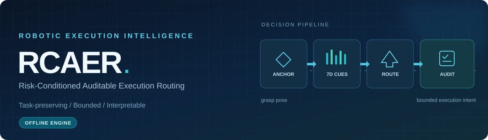
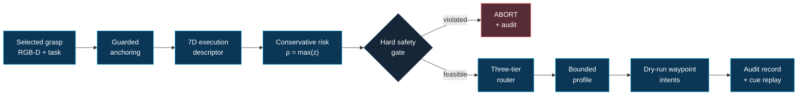

<div align="center">

# RCAER

### Risk-Conditioned Auditable Execution Routing

**From a selected grasp to a bounded, inspectable execution decision.**



[](https://github.com/Gentle-milky-way/RCAER/actions/workflows/ci.yml)   

**Interpretable by design. Bounded by construction. Auditable per pick.**

</div>

---

## Why execution deserves its own decision

A selected 6-DoF grasp tells a robot **where** to pick. It does not specify **how** to approach, make contact, close, lift, and recover when depth is missing, a finger is near the table, or the object is easy to deform.

**RCAER** is a small, clean-room Python reference implementation of the execution-adaptation layer described in *Risk-Conditioned Auditable Execution Routing for Vision-Guided Robotic Picking in High-Mix Production*. It separates **task-target preservation**, **execution-condition assessment**, **bounded routing**, and **auditability** from the upstream grasp selector.

> [!IMPORTANT]
> **Scope:** this is a tested **offline decision engine**, not the original private experiment repository, an executable Franka controller, or a recreation of the paper’s robot trials. The geometric waypoints are **intents only**. Do not send them directly to hardware.

## The idea in one diagram



Seven interpretable cues describe *why* a grasp may be difficult:

| Cue | Signal | Failure mode it highlights |
|:---:|---|---|
| `zD` | Depth validity / noise | Transparent or reflective surfaces |
| `zH` | Object height | Low-profile targets |
| `zT` | Table-clearance margins | Finger/table interference |
| `zE` | Distance to object-mask edge | Fragile edge anchoring |
| `zM` | Annotated material prior | Thin-walled, reflective, deformable objects |
| `zA` | Reachability / safety margins | Workspace, tilt, offset, rotation limits |
| `zC` | Opening and contact-area proxy | Weak contact formation |

The routing rule is intentionally simple: `ρ = max(zD, zH, zT, zE, zM, zA, zC)`.

| Risk tier | Threshold | Speed scale | Approach offset | Probe | Compliance | Gripper force |
|---|---|---:|---:|---:|---|---:|
| **Low** | `ρ < 0.50` | `0.80` | `80 mm` | `0 mm` | nominal | `40 N` |
| **Mid** | `0.50 ≤ ρ < 0.70` | `0.60` | `90 mm` | `2 mm` | medium-soft | `25 N` |
| **High** | `ρ ≥ 0.70` | `0.45` | `100 mm` | `4 mm` | soft | `15 N` |

These parameters reproduce the **manuscript’s one-cell codebook**, not general-purpose safety limits. Stiffness, damping, closing speed, and all guard thresholds are in [`src/rcaer/config.py`](src/rcaer/config.py). The **hard abort gate is independent of risk tier**: an unsafe grasp is rejected, not just slowed down.

## Quick start

**Requires Python 3.10+.**

```bash
git clone https://github.com/Gentle-milky-way/RCAER.git
cd RCAER
python -m pip install -e ".[dev]"
pytest -q
python examples/demo.py
```

The demo constructs a **synthetic** RGB-D-like observation and prints a complete decision/audit record. No physical robot is commanded.

Explore route decisions on logged 7D cues:

```bash
rcaer replay examples/cues.jsonl
rcaer replay examples/cues.jsonl --remove-cue zC
rcaer replay examples/cues.jsonl --material 0.65
```

`replay` produces **tier/profile counterfactuals**, **not** physical outcome predictions or evidence of improved grasp success.

## Python interface

```python
from rcaer import decide, audit_to_json, replay
from examples.demo import make_demo_packet

packet = make_demo_packet()           # synthetic calibrated packet
decision = decide(packet, mode="M3")  # guarded + routed

print(decision.tier, decision.risk, decision.aborted)
print(audit_to_json(decision))

if decision.cues is not None:
    print(replay(decision.cues, remove_cue="zM"))
```

The same interface provides the paper’s three controlled configurations:

| Mode | Anchor | Execution parameters |
|---|---|---|
| **M1** | Raw selected grasp | Fixed low-tier profile |
| **M2** | Guarded grasp | Same fixed low-tier profile |
| **M3** | Guarded grasp | Risk-conditioned profile |

## Repository map

```text
RCAER/
├── assets/                  # Project artwork
├── src/rcaer/
│   ├── guard.py             # Task-preserving local anchor projection
│   ├── descriptor.py        # Seven normalized execution cues
│   ├── router.py            # Max-risk tiering, profile clipping, cue replay
│   ├── planning.py          # Hard gate + geometric waypoint intents
│   ├── engine.py            # End-to-end decision and audit
│   ├── config.py            # Paper-aligned codebook and bounds
│   ├── models.py            # Typed observation / decision contracts
│   └── cli.py               # Offline replay CLI
├── examples/                # Synthetic demo and replay inputs
├── tests/                   # Unit/integration tests
├── docs/                    # Implementation fidelity and limitations
└── .github/workflows/       # Automated tests
```

## Reproducibility, not overclaiming

- **Implemented directly:** seven-cue normalization logic, max-risk aggregation, tier thresholds, profile values, bounded projection, the decision/audit interfaces.
- **Faithful but approximate:** local semantic-mask anchor projection; the manuscript does not expose every original anchoring heuristic.
- **Inputs supplied by an integrator:** calibrated RGB-D/point clouds, task-mask, safety margins, reachability decisions, contact proxy, material record.
- **Outside this release:** trained GraspMolmo/M2T2 front end, IK, collision-aware trajectories, FR3/Robotiq drivers, live compliance/probing control, original trial data, and hardware validation.

Read [implementation notes](docs/IMPLEMENTATION_NOTES.md) for the exact method-to-code crosswalk and limitations.

## Research reference

**Manuscript:** *Risk-Conditioned Auditable Execution Routing for Vision-Guided Robotic Picking in High-Mix Production* — the method described in the accompanying research manuscript. Publication and authorship metadata should be verified before adding a formal citation; the anonymous-review PDF is not redistributed here.

> **Usage and license:** Source is publicly viewable. **No open-source license has been granted yet.** Public visibility does not itself authorize redistribution, modification, or commercial use. Do not infer that this code is safety-certified.

<div align="center">

<sub>Built to make grasp execution decisions understandable, inspectable, and reproducible.</sub>

</div>
